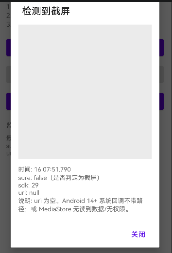

# Screenshot-observer

Android 截屏监听库。业务侧**无需、也不会由本库申请**读图/读存储权限。

# usage


# 兼容性

参考：

https://github.com/DoubleD0721/Screenshot

目前 Android 针对截屏的监控主要有三种方式：

1. 利用 FileObserver 监听某个目录中资源的变化
2. 利用 ContentObserver 监听全部资源的变化
3. 直接监听截屏快捷键（由于不同厂商自定义的原因，使用这种方法进行监听比较困难）

本库：
- **Android 14 以下**：ContentObserver 监听 MediaStore 图片变化，再尝试判断是否为截屏
- **Android 14 及以上**：系统 `ScreenCaptureCallback`（权限 `DETECT_SCREEN_CAPTURE`，默认授予、用户无感知）

---

## 给产品 / 业务：版本 × 权限能力说明

本库**不会申请**读图/读存储权限。实际能力取决于：**系统版本** + **宿主 App 是否自行声明并持有读图权限**。

若业务 App 已完全去掉读图/读存储权限，请以「无读图权限」列为准。

### 总览

| Android 版本 | 技术方案 | 无读图权限 | 有读图权限 |
| --- | --- | --- | --- |
| **14 及以上** | 系统官方截屏回调 | 能感知「发生了截屏」；**无图片、无路径** | 同左（系统本身就不给路径） |
| **13 及以下** | 监听系统「图片库」变化再判断 | **不能可靠当作截屏成功**；图库变动常会误触达业务，且**无图** | 可较准确判断是否截屏，并尽量给出图片路径 |

### Android 14 及以上

- 使用系统提供的截屏监听能力。
- **与是否有读图权限无关**。
- 产品可依赖：「用户截了屏」这一事件。
- 产品**不能依赖**：截屏文件、预览图、分享原图路径（回调里没有图，一般为 `uri == null`，`sure == true`）。

### Android 13 及以下（含 Android 9 / 10 等）

- 通过监听「手机图库有新图」来间接判断是不是截屏。
- **图库一有变化就可能被惊动**，来源可能是：
  - 系统截屏
  - 其他 App 拍照
  - 保存 / 下载图片等  
  → **不等于「一定是截屏」**。

**无读图权限时（常见于已去存储权限的线上 App）：**

| 现象 | 说明 |
| --- | --- |
| 有时仍会收到回调 | 只是图库发生了变化，**不是**确认截屏 |
| 没有图片地址 | `uri == null`，读不到图库内容 |
| 判定为不确定 | `sure == false`，不能当成功截屏用 |
| 其他 App 拍照也可能进来 | 正常现象：监听的是整个 MediaStore 图片库 |

**有读图权限时：**

| 现象 | 说明 |
| --- | --- |
| 可按规则进一步过滤 | 路径关键字（如 screenshot）、时间、尺寸等 |
| 更接近「真截屏」 | 误报会少很多（仍无法 100% 排除厂商差异） |
| 通常能拿到图片路径 | 可用于展示 / 上报（仍受系统与厂商限制） |

### Demo 实测：无权限时的回调形态

未申请读图权限时，媒体库一有变动（截屏或其他 App 拍照等），仍可能弹出检测结果，但 **`sure = false` 且 `uri = null`**，预览区无图：



图中信息解读：

- `sure: false`：未能认定是截屏（无权限查不到具体图片数据）
- `uri: null`：没有可用图片路径
- `sdk: 29`：示例机为 Android 10；Android 13 及以下无权限时行为同类
- 说明文案：Android 14+ 系统回调本身不带路径；或 MediaStore 无读到数据 / 无权限

**结论：这种回调不能当作「截屏成功」。** 业务应区分：

- `sure == true`：较可信的截屏（低版本有权限且规则命中，或 Android 14+ 系统回调）
- `sure == false` 或 `uri == null`（低版本）：仅表示媒体库可能有变动，**不要当截屏成功处理**

### 给产品的结论（结合「已完全去掉读图权限」）

1. **Android 14+**：可以做「截屏后触发某逻辑」（如风控提示、隐藏敏感信息），但不要设计「弹截图预览 / 上传截图文件」。
2. **Android 13 及以下**：在无权限前提下，不建议把回调当成真实截屏成功；拍照等操作也可能触发，且没有可用图片。
3. Demo 里「申请读图权限」**仅用于开发自测**，不代表库或线上 App 会申请该权限。
4. 若低版本也要「可靠截屏感知」，需单独评估：恢复读图权限，或接受低版本能力降级 / 不支持。

### 一句话版

> 无读图权限时：Android 14+ 只能知道「截了屏」、没有图；Android 13 及以下只能感知「图库可能变了」，无法可靠区分截屏 / 拍照，也没有图。有读图权限时，低版本才能较稳地识别截屏并尝试拿到路径。

---

## Android 各版本与权限（技术补充）

主要针对 Android 13 / 14 的存储与截屏相关能力：

- Android 13：存储权限细化为 `READ_MEDIA_IMAGES` / `READ_MEDIA_VIDEO` / `READ_MEDIA_AUDIO`。
- Android 14：增加截屏监控相关能力 `DETECT_SCREEN_CAPTURE`（本库已在 `observer` 模块声明）；系统截屏回调可不依赖相册权限，但拿不到截屏文件。

| 权限状态 | Android 13 及以下 | Android 14 及以上 |
| --- | --- | --- |
| 有全部相册权限 | MediaStore 监控，可查图并尽量判断是否截屏 | 推荐用系统 API 监控（拿不到截屏文件）；也可用媒体库方案 |
| 有部分相册权限 | 无法可靠查到截屏文件 / 判定 | 使用系统 API 监控（拿不到截屏文件） |
| 没有相册权限 | ContentObserver **仍可能收到** `onChange`，但查不到具体数据，只能弱回调（`uri=null`, `sure=false`），且拍照等也会触发 | 使用系统 API 监控（拿不到截屏文件） |

补充：

- 在 Android 13 及以下、**没有相册/存储权限**时，`registerContentObserver` 在 MediaStore 有新增/修改/删除时**仍可能收到回调**，但无法查询具体哪条数据、也无法用修改时间/尺寸等判断是否为截图。
- 若将监听限定在 App 前台（如 `onStart` 注册、`onStop` 注销），误报会少一些，但仍无法从技术上排除其他 App 后台改图库；**无权限时仍不应把弱回调当成截屏成功**。

# 使用

```gradle
dependencyResolutionManagement {
    repositoriesMode.set(RepositoriesMode.FAIL_ON_PROJECT_REPOS)
    repositories {
        mavenCentral()
        maven { url 'https://jitpack.io' }
    }
}

dependencies {
    implementation 'com.github.hss01248.screenshot-observer:observer:1.0.2'
}
```

### 推荐：在 Activity 前台注册，离开前台注销

```java
@Override
protected void onStart() {
    super.onStart();
    ScreenshotObserverUtil.registerObserver(this, new ScreenshotCallback() {
        @Override
        public void onCapture(@Nullable Uri uri, boolean sure) {
            // 见下方「回调参数」与「注意事项」
            if (!sure) {
                // Android 13 及以下、无读图权限时常见：图库变动弱回调，勿当截屏成功
                return;
            }
            // Android 14+：uri 通常为 null，只能做「发生了截屏」类逻辑
            // Android 13 及以下且有权限并判定成功时：uri 可能为 file/content
        }
    });
}

@Override
protected void onStop() {
    ScreenshotObserverUtil.unRegisterObserver(this);
    super.onStop();
}
```

Demo 也可用按钮手动「开启 / 关闭监听」，原理相同：成对调用 `registerObserver` / `unRegisterObserver`。

### 回调参数 `onCapture(Uri uri, boolean sure)`

| 场景 | `sure` | `uri` |
| --- | --- | --- |
| Android 14+ 系统截屏回调 | `true` | 一般为 `null`（系统不给文件） |
| Android 13 及以下，规则判定为截屏 | `true` | 可能有路径（依赖读图权限与 ROM） |
| Android 13 及以下，无权限或查不到数据 | `false` | `null`（其他 App 拍照等也可能触发） |

### 注意事项

1. **成对注册 / 注销**  
   建议 `onStart`↔`onStop`（或业务等价的前台区间）。漏调 `unRegisterObserver` 可能多占监听；库在 `Activity.onDestroy` 时会尝试自动注销，但业务仍应显式成对调用。

2. **回调线程**  
   业务回调会抛到**主线程**。`register` / `unRegister` 可在任意线程调用。

3. **务必看 `sure`，不要只看「有没有回调」**  
   无读图权限时，低版本收到回调 ≠ 截屏成功。产品逻辑见上文「版本 × 权限能力说明」。

4. **本库不申请读图 / 读存储权限**  
   `observer` 仅声明 `DETECT_SCREEN_CAPTURE`（Android 14+）。是否声明/申请相册权限由宿主 App 决定；Demo 里的权限按钮仅供自测。

5. **多 Activity**  
   可同时注册多个 Activity；&lt;14 时底层共享一套 MediaStore 监听，截屏事件会分发给当前仍注册且未销毁的页面。Android 14+ 为每个 Activity 各自注册系统回调。

6. **Callback 勿隐式强持 Activity**  
   内部用 `WeakHashMap` 降低泄漏风险，但若 `ScreenshotCallback` 是 Activity 非静态内部类，仍可能钉住页面；优先独立类 / 静态类 / 只捕获必要字段。

7. **前台限定可降误报，不能消除**  
   仅在前台监听时，低版本误报会少一些，但仍无法从技术上排除其他 App 改图库；无权限时更不能把弱回调当截屏成功。
